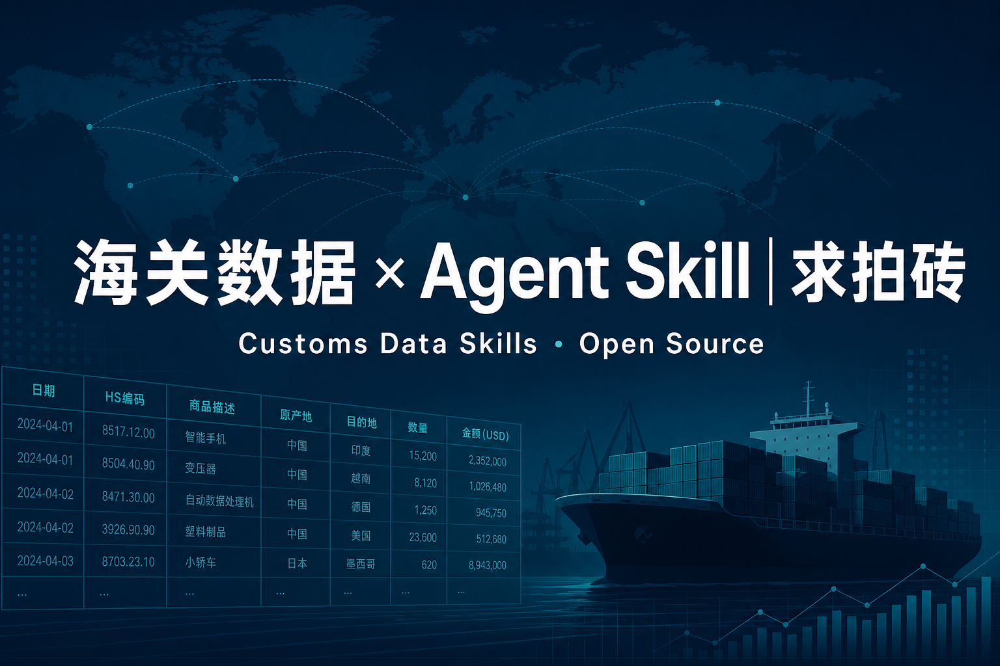

# 海关数据找客户，我开源了一套 Agent Skill——求拍砖

> 封面图：

---

## 标题

1. **海关数据找客户，我开源了一套 Agent Skill——求拍砖**

**摘要 / 导读（推送列表用）：**  
很多团队还在「搜公司 → 群发同一封开发信」。我把「HS → 宏观选市 → 真实采购商（或二次线索）→ 评分 → 转译开发信」写成可给 AI Agent 直接调用的开源 Skill，并附带一线避坑质检。欢迎外贸同行、数据顾问、Agent 开发者一起拍砖。

---

## 正文

### 写在前面

做外贸开发的人都知道：海关数据很香，也很容易踩坑。

香在哪里？它能回答三件正事——

1. **哪个市场在买**
2. **哪些公司确实买过**
3. **现在有没有切入供应链的机会**

坑在哪里？Consignee 可能只是货代或清关行（Customs Broker）；很多大买家申请了海关隐私遮蔽，提单上只剩 `To Order`；UN Comtrade 只能看宏观趋势，**绝对看不到公司名**；平台搜不到不等于不进口；统计单价不能当报价依据；开发信里一旦写「我查了你们海关数据」，信任瞬间清零。

过去这类经验多散落在分享会、付费课和私人文档里。我想试一件更朴素的事：

> **把流程和避坑规则，写成 Agent 能直接调用的 Skill，而不是又一篇收藏向长文。**

于是有了开源包 **Customs Data Skills**（MIT）。今天公开出来，目的很明确：**用、改、骂、提意见，都行——就怕没人用。**

---

### 这套东西是什么

两个 Skill，成对使用：

| Skill | 干什么 |
|---|---|
| **customs-lead-sop** | 完整 SOP：确认 HS → 用统计做市场分层 → 找真实进口商（或二次线索 / 用户导出表）→ 评分分层 → 联系人 + **转译后的**开发信草稿 → 落盘报告 |
| **customs-pitfalls** | 避坑质检：货代/清关行误判、`To Order`/AMS 遮蔽、统计库当买家库、无记录≠不进口、统计单价误用、群发、HS 未核实、转口枢纽、关税忽略、开发信暴露数据源…… |

它跑在常见 Agent 运行时上：**Cursor / Codex / OpenClaw / Claude Code** 等兼容 Agent Skills 的客户端都能装。  
一键脚本或手动复制 `skills/` 即可，不绑死某一个 IDE。

**数据源怎么分工（老鸟最在意的一句）：**

- 用 **UN Comtrade / 各国海关统计** 做宏观选市——规模、增长、中国份额；**它们没有买家公司名**  
- 用 **ImportYeti 等** 抓 **美国海运提单** 买家——美线很强，对欧洲/东南亚/中东/拉美作用有限  
- **英国及多数欧盟国家**受隐私规则约束，官方早已不公开美式「逐票 Consignee 提单」；这些市场靠展会名录、协会、新闻、LinkedIn 等二次线索，或把付费库导出交给 Skill  
- 本 Skill **不绑定任何付费海关库**。免费入口可以直接跑；如果你公司已经买了昂贵的海关软件，**把导出的 CSV/Excel 丢给它**，让它帮你完成后面最繁重的清洗、买家评分和草稿生成——这也是撞上反爬/登录墙时的正解，而不是幻想 Agent 能裸爬打穿所有站点

---

### 为什么要做成 Skill，而不是「方法论 PDF」

因为真正难的不是「知道步骤」，而是：

- 每次任务都能按同一顺序执行，且 **统计层与企业层不混用**  
- 交付前强制过一遍避坑清单（含 `To Order`、清关行、Comtrade 禁推公司名）  
- 每条买家线索都带着证据字段：来源类型、最近出货窗口、HS/关键词证据、评分、分层、风险标记  
- 开发信不只「禁止暴露」，还要求把海关字段 **转译** 成产品/供应链观察

换句话说：给 AI 的不是「灵感」，是**可执行的操作手册 + 质检门禁**。

举例（宠物碗 / 美英加）：先核实 HS，用 Comtrade 等比市场规模与中国份额；美国再用提单工具反查并过滤假阳性；英国等市场走二次线索或付费导出；最后按品牌商 / 批发商 / 电商 / 连锁等分型写切入点。名单可能比群发名单短，但成交概率通常更高。

开发信也不只是「别提海关」——不能写「我看到你三个月前从 A 公司进了两柜」，但可以写：「我注意到贵司宠物碗产品线主打不锈钢双碗设计，我们在抛光工艺与 MOQ 上或许能配合下一轮补货。」**证据在内部，表达在客户价值。**

---

### 我刻意守住的边界（也请你们监督）

开源不等于「什么都能干」。这套 Skill 默认硬规则包括：

- **只用公开贸易 / 提单 / 统计与公开网页**（以及你有权使用的自有导出）  
- **不自动群发邮件**——只产出草稿，发出去的决定在人  
- **客户可见文案禁止暴露「查了海关 / 提单 / 某数据平台」**，且必须完成字段转译  
- 遇登录墙 / 反爬：**请你导出表接续**，不教绕墙、不编造买家行  
- 不伪造官方名单、不承诺「一定能过」之类话术  

如果你们在使用中发现哪条规则过严、过松、或和实务冲突——**请直接说**。避坑清单本来就该被一线打磨。

---

### 怎么试用（极简版）

装好后，可以对 Agent 说类似：

```text
/customs-lead-sop
产品：宠物碗；目标：US/UK/CA；同行：Xxx Co Ltd
按完整 SOP 执行，强制 customs-pitfalls 质检，报告写入 ./hunt_result/
```

若美国站被反爬，或你本就有付费库：

```text
/customs-lead-sop
已导出提单表：./exports/us-pet-bowl.csv
请跳过抓取，直接清洗、过滤 To Order/货代/清关行、评分并写开发信草稿
```

仓库里有安装脚本（Windows / macOS / Linux）、`AGENTS.md` 操作手册，以及宠物用品实操示例。  
本地路径：`opengit/customs-data-skills/`  
协议：**MIT**，欢迎 fork、改、提 PR。

---

### 最想听你们拍这几板砖

我公开这套东西，不是求点赞，是求**校准**。尤其欢迎：

1. **一线业务**：哪些市场工具过时了？哪些国家入口该补进 `tools.md`？非美线二次线索还有哪些稳？  
2. **海关/贸促顾问**：HS 确认、关税解读、转口枢纽、`To Order`/AMS 表述，有没有更稳妥的写法？  
3. **数据/合规同学**：公开数据使用边界、开发信转译红线，还有哪些必须写进 Skill？  
4. **Agent 开发者**：CSV 交接、评分卡、跨运行时安装，哪里用着别扭？  
5. **多语言开发**：英文开发信语气、禁忌句式，有没有你们踩过的坑可贡献进示例？

贡献方向也很具体（见仓库 `CONTRIBUTING.md`）：补国家工具表、评分案例、多语言开发信红线；原则是 **证据优先于名单长度**，**公开来源优先于绕墙技巧**。

---

### 结尾

海关数据是**线索信号**，不是成交合同。转化仍然取决于调研、联系人、价值主张和跟进。

我只是把「怎么查、怎么排、怎么不踩雷」写成了 Agent 可调用的流程。  
如果它帮你少发了十封无效群发、少把货代或清关行当成买家、少把 Comtrade 当成客户库——就已经值了；  
如果它哪里不对、哪里太理想化——**留言、私信、提 Issue，都行。**

**求使用，求吐槽，求指导。**  
下一版想靠你们的实战反馈长出来，而不是靠我关起门来写说明书。

（评论区可直接写：你所在品类 / 目标市场 / 用过哪类海关工具 / 最想先改哪一块。）

---

## 发布备注

- **封面图**：同目录 `cover-customs-agent-skill.png`，文案「海关数据 × Agent Skill｜求拍砖」
- **合规提示（可选文末）**：不构成投资或成交承诺，数据以公开来源与官网为准；各国公开范围会变
- **互动引导**：点「在看」的同时，更希望留下一条真实吐槽
